# Projet eBank — Architecture microservices et agent IA

**Réalisé par :** Nawal El Aaraj — ENSET

Dans ce projet, j'ai construit une petite application bancaire selon une **architecture microservices**
avec Spring Boot 4 et Spring Cloud 2025.1. J'y ai ajouté un **agent IA** (Spring AI 2.0) qui répond
aux questions en langage naturel en interrogeant les microservices via le protocole **MCP**
(Model Context Protocol), puis une **interface web Angular** qui regroupe la gestion des clients,
des comptes et l'accès à l'assistant.

## Sommaire

1. [Objectifs](#1-objectifs)
2. [Organisation du dépôt](#2-organisation-du-dépôt)
3. [Partie Backend](#3-partie-backend)
4. [Partie Frontend](#4-partie-frontend)
5. [Sécurité](#5-sécurité)
6. [Difficultés rencontrées](#6-difficultés-rencontrées)
7. [Conclusion](#7-conclusion)

---

## 1. Objectifs

- Découper l'application en microservices indépendants (clients, comptes) avec leur propre base de données.
- Mettre en place l'enregistrement et la découverte des services (**Eureka**) et un point d'entrée unique (**Gateway**).
- Faire communiquer les services entre eux avec **OpenFeign** et rendre l'appel résistant aux pannes
  avec un **circuit breaker** (Resilience4j).
- Exposer les données sous forme d'outils **MCP** pour qu'un agent IA puisse les utiliser.
- Développer un **chatbot** accessible en REST et sur **Telegram**, avec mémoire de conversation.
- Réaliser un **frontend Angular** qui consomme l'API à travers la gateway.

## 2. Organisation du dépôt

```
ebank_ms_app/
├── backend/
│   ├── DISCOVERY-SERVICE/       annuaire Eureka
│   ├── customer-service/        clients + serveur MCP
│   ├── ebank-service/           comptes + OpenFeign/circuit breaker + serveur MCP
│   ├── gateway-service/         point d'entrée unique + CORS
│   └── ebank-chatbot-service/   agent IA (client MCP), REST /chat, bot Telegram
├── frontend/                    application Angular
├── captures/
│   ├── backend/                 captures des tests du backend
│   └── frontend/                captures de l'interface
└── README.md                    ce rapport
```

---

## 3. Partie Backend

### 3.1 Architecture

```
                         ┌──────────────────────┐
                         │  DISCOVERY-SERVICE   │  Eureka :8761
                         └──────────▲───────────┘
                                    │ enregistrement
   Frontend Angular :4200           │
          │             ┌───────────┴───────────┐
          └──────────►  │   gateway-service     │  :9999 (Spring Cloud Gateway, discovery locator, CORS)
                        └──┬─────────┬────────┬─┘
                           │         │        │
                ┌──────────▼──┐ ┌────▼──────┐ ┌▼──────────────────────┐     ┌──────────┐
                │customer-    │ │ebank-     │ │ebank-chatbot-service  │◄───►│ Telegram │
                │service :8056│ │service    │ │:8058                  │     └──────────┘
                │             │◄┤:8057      │ │ BankAgent (ChatClient)│
                │ MCP /mcp    │ │ MCP /mcp  │ │ + mémoire par chatId  │────► LLM : Ollama (qwen3)
                └──────▲──────┘ └─────▲─────┘ └───────────┬───────────┘      ou Groq (gpt-oss-120b)
                       │   Feign +    │                   │
                       │   CircuitBreaker                 │
                       └──────────────┴───── MCP Streamable HTTP ──┘
```

| Module | Port | Rôle |
|---|---|---|
| `DISCOVERY-SERVICE` | 8761 | Annuaire Eureka |
| `customer-service` | 8056 | Gestion des clients (JPA/H2) + serveur MCP |
| `ebank-service` | 8057 | Comptes bancaires (JPA/H2), appelle customer-service via OpenFeign + Resilience4j, serveur MCP |
| `ebank-chatbot-service` | 8058 | Agent IA (Spring AI + Ollama ou Groq), client MCP, REST `/chat` et bot Telegram |
| `gateway-service` | 9999 | Point d'entrée unique, routes automatiques via Eureka, CORS pour le frontend |

### 3.2 customer-service

J'ai créé l'entité `Customer` (`id`, `name`, `email`) stockée dans une base H2 en mémoire,
avec trois clients insérés au démarrage (Mohamed, Imane, Yassine).

| Méthode | URL | Description |
|---|---|---|
| GET | `/customers` | Liste des clients |
| GET | `/customers/{id}` | Un client |
| POST | `/customers` | Création d'un client (`{name, email}`) |

### 3.3 ebank-service, OpenFeign et circuit breaker

L'entité `BankAccount` (`id` UUID, `createdAt`, `balance`, `type`, `customerId`) contient aussi un champ
`customer` non persisté (`@Transient`), que je remplis en appelant customer-service avec un client
**OpenFeign** (`CustomerRestClient`). Au démarrage, je crée 5 comptes par client.

| Méthode | URL | Description |
|---|---|---|
| GET | `/accounts` | Liste des comptes |
| GET | `/accounts/{id}` | Un compte avec son client (appel Feign) |
| POST | `/accounts` | Ouverture d'un compte (`{balance, type, customerId}`) |

Pour que ebank-service continue de répondre quand customer-service est en panne, j'ai activé le
circuit breaker d'OpenFeign (`spring.cloud.openfeign.circuitbreaker.enabled=true`). La classe
`CustomerRestClientFallback` renvoie alors un client par défaut (`NoName` / `noEmail`) au lieu d'une erreur 500.

### 3.4 Gateway

La gateway utilise le *discovery locator* : chaque service enregistré dans Eureka est accessible
automatiquement sous `/NOM-DU-SERVICE/**` (par exemple `http://localhost:9999/CUSTOMER-SERVICE/customers`).
J'y ai aussi configuré le **CORS** (origine `http://localhost:4200`) pour que le frontend Angular
puisse appeler tous les services en passant par ce point d'entrée unique.

### 3.5 Serveurs MCP

customer-service et ebank-service exposent chacun un serveur MCP (transport Streamable HTTP, endpoint `/mcp`).
Les méthodes annotées `@Tool` deviennent des outils utilisables par l'agent IA :

| Service | Outil | Description |
|---|---|---|
| customer-service | `getAllCustomers` | Liste de tous les clients |
| customer-service | `getCustomerById(id)` | Un client par son id |
| ebank-service | `getAllBankAccounts` | Liste de tous les comptes |
| ebank-service | `getBankAccountById(id)` | Un compte avec son client |

### 3.6 Chatbot (ebank-chatbot-service)

Le chatbot est un **client MCP** : au démarrage, il récupère les outils des deux serveurs MCP et les
donne au `ChatClient` de Spring AI dans la classe `BankAgent`. Le prompt système oblige l'agent à
utiliser ces outils et à ne jamais inventer de client, de compte ou de solde.

- **Mémoire** : `MessageWindowChatMemory` garde les 20 derniers messages de chaque conversation,
  identifiée par un `chatId` (id du chat Telegram, ou paramètre de `/chat`).
- **REST** : `GET /chat?question=...&chatId=...` renvoie la réponse en texte.
- **Telegram** : le bot fonctionne en *long polling* si la variable `TELEGRAM_BOT_TOKEN` est définie.
- **Choix du LLM** : j'ai prévu deux possibilités, Ollama en local ou Groq en ligne (API compatible OpenAI) :

| Variable | Valeur par défaut | Rôle |
|---|---|---|
| `LLM_PROVIDER` | `ollama` | `ollama` = LLM local ; `openai` = API compatible OpenAI (Groq) |
| `GROQ_API_KEY` | *(vide)* | Clé Groq, obligatoire si `LLM_PROVIDER=openai` |
| `GROQ_MODEL` | `openai/gpt-oss-120b` | Modèle Groq utilisé (optionnel) |

### 3.7 Lancement

Prérequis : Java 21, et un LLM au choix :
[Ollama](https://ollama.com/download) avec `ollama pull qwen3:8b`, ou une clé API
[Groq](https://console.groq.com/keys). Le bot Telegram est optionnel (créé avec [@BotFather](https://t.me/BotFather)).

```powershell
# 1. LLM : Ollama doit tourner (http://localhost:11434)...
ollama pull qwen3:8b
#    ...ou bien Groq (dans le terminal du chatbot, avant l'étape 5)
$env:LLM_PROVIDER = "openai"
$env:GROQ_API_KEY = "<clé Groq>"               # jamais commitée

# 2. Eureka
cd backend\DISCOVERY-SERVICE;      .\mvnw spring-boot:run
# 3. Clients
cd backend\customer-service;       .\mvnw spring-boot:run
# 4. Comptes
cd backend\ebank-service;          .\mvnw spring-boot:run
# 5. Chatbot (APRÈS customer-service et ebank-service : connexion MCP au démarrage)
$env:TELEGRAM_BOT_TOKEN = "<token BotFather>"   # optionnel, jamais commité
cd backend\ebank-chatbot-service;  .\mvnw spring-boot:run
# 6. Gateway
cd backend\gateway-service;        .\mvnw spring-boot:run
```

> Sans `TELEGRAM_BOT_TOKEN`, le bot Telegram est simplement désactivé ; `/chat` reste utilisable.

### 3.8 Tests et captures d'écran

#### Eureka — services enregistrés

http://localhost:8761 : les quatre services sont à l'état UP.

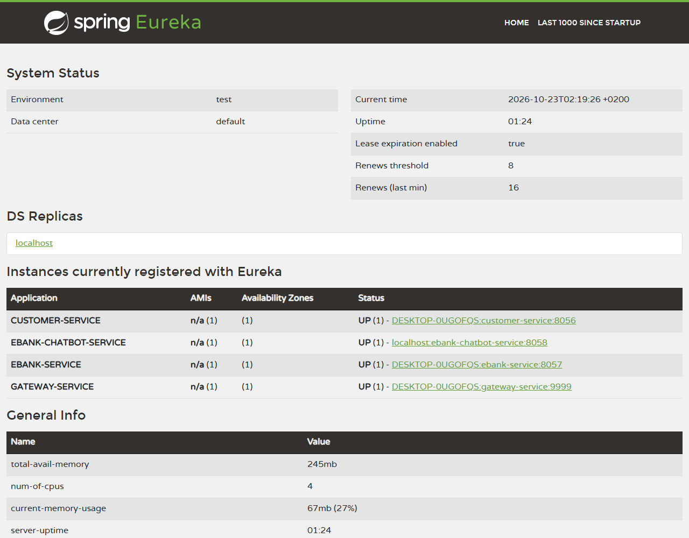

#### customer-service

`GET /customers` puis `GET /customers/1` :

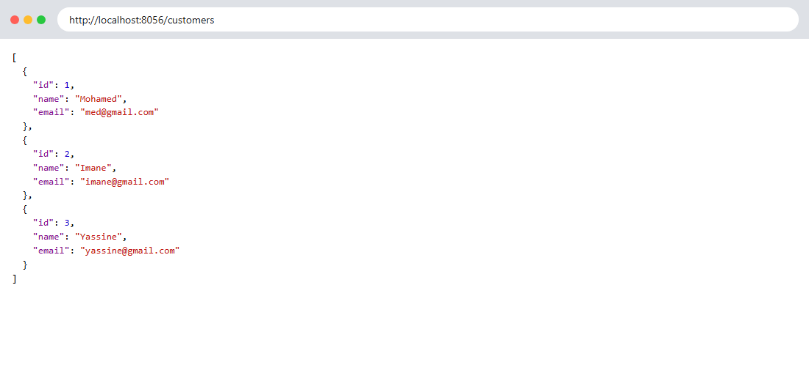


Documentation Swagger (http://localhost:8056/swagger-ui.html) :


#### ebank-service

`GET /accounts` :

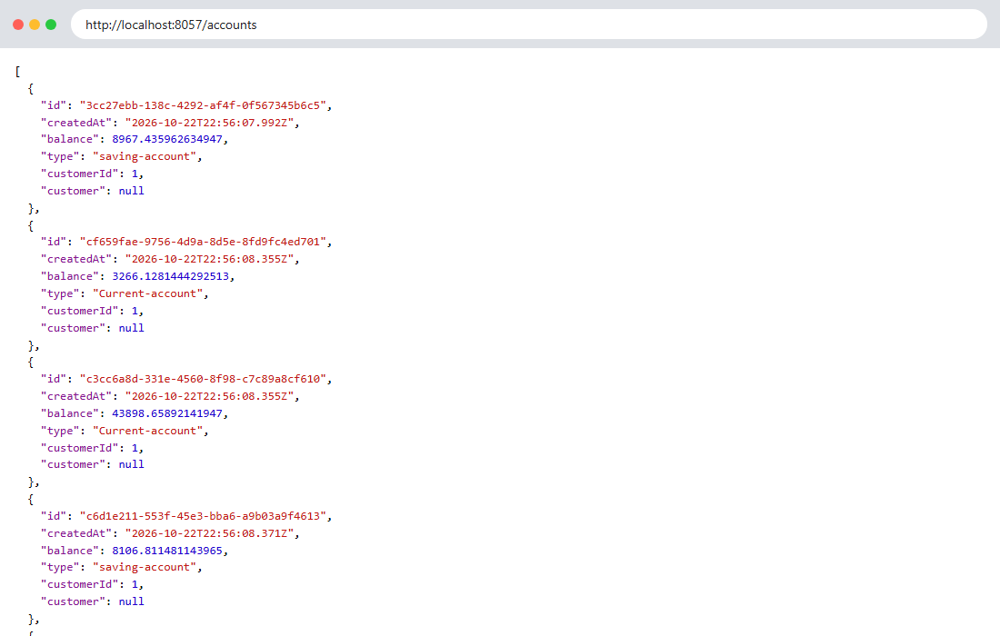

`GET /accounts/{id}` : l'objet `customer` est rempli grâce à l'appel Feign vers customer-service.

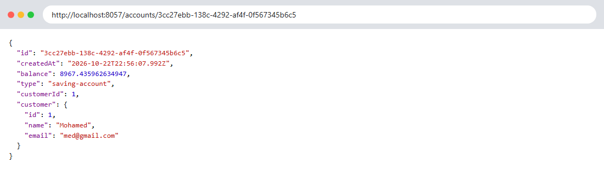

Documentation Swagger (http://localhost:8057/swagger-ui.html) :

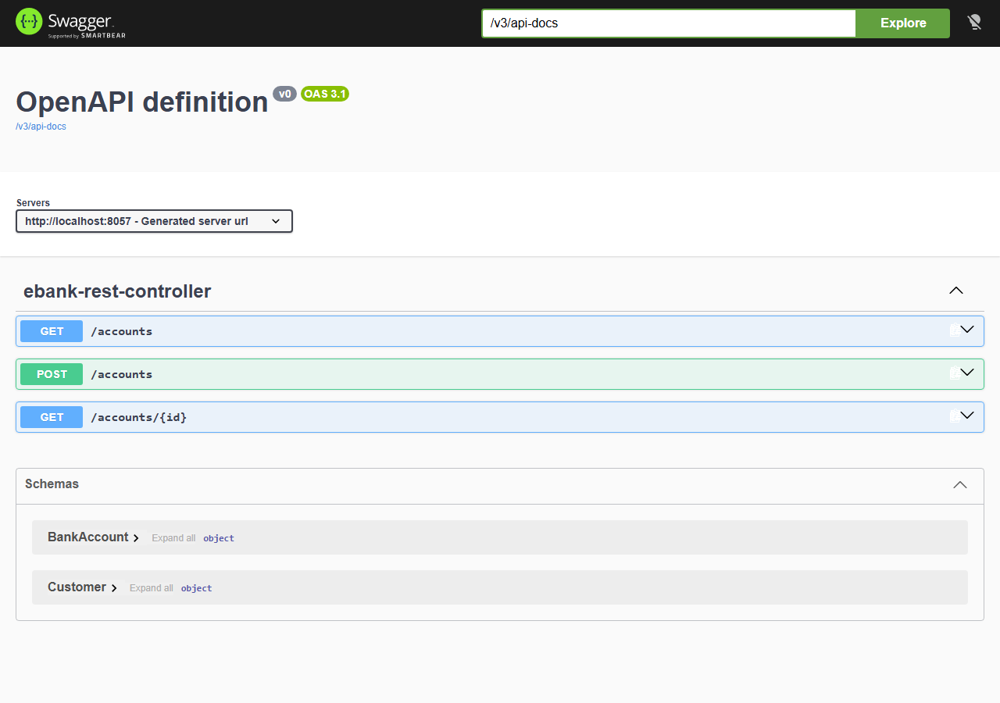

Console H2 (http://localhost:8057/h2-console, JDBC URL `jdbc:h2:mem:accounts-db`, utilisateur `sa`) :


#### Circuit breaker

J'ai arrêté customer-service puis rappelé `GET /accounts/{id}` : le fallback renvoie
`"customer": {"name": "NoName", "email": "noEmail"}` au lieu d'une erreur 500.


#### Gateway

`/CUSTOMER-SERVICE/customers` et `/EBANK-SERVICE/accounts` via le port 9999 :

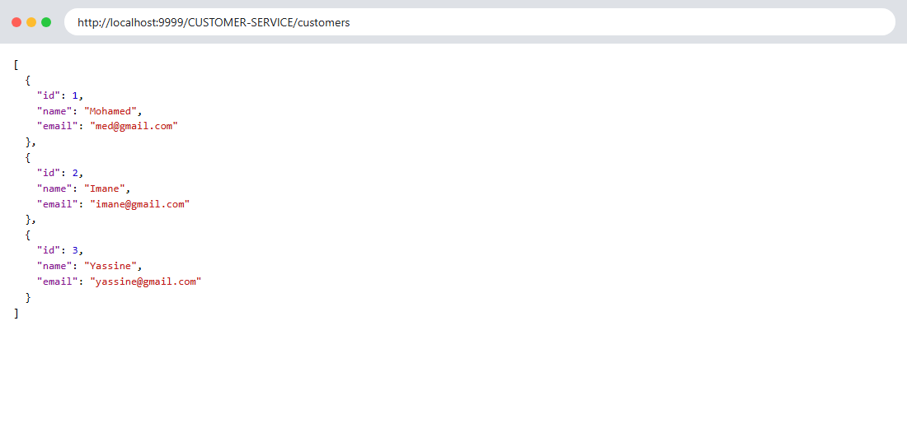


#### Serveurs MCP

Réponse JSON-RPC `tools/list` de chaque serveur MCP :

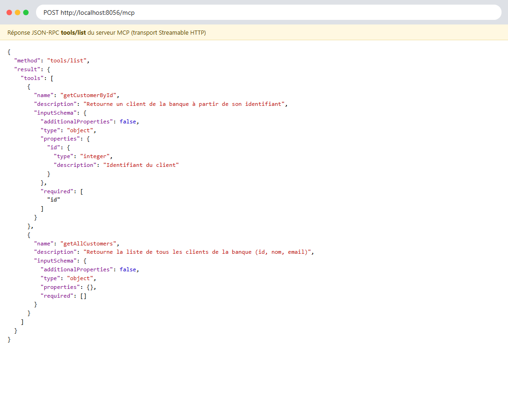

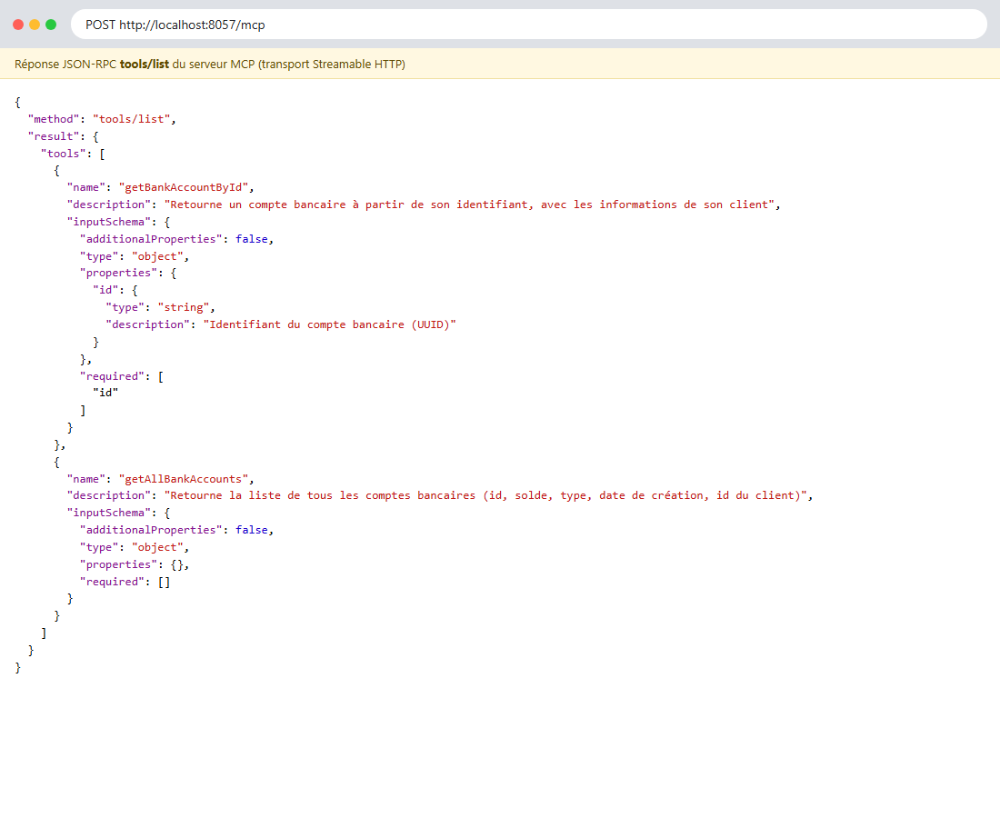

#### Chatbot — endpoint `/chat`

Liste des clients :

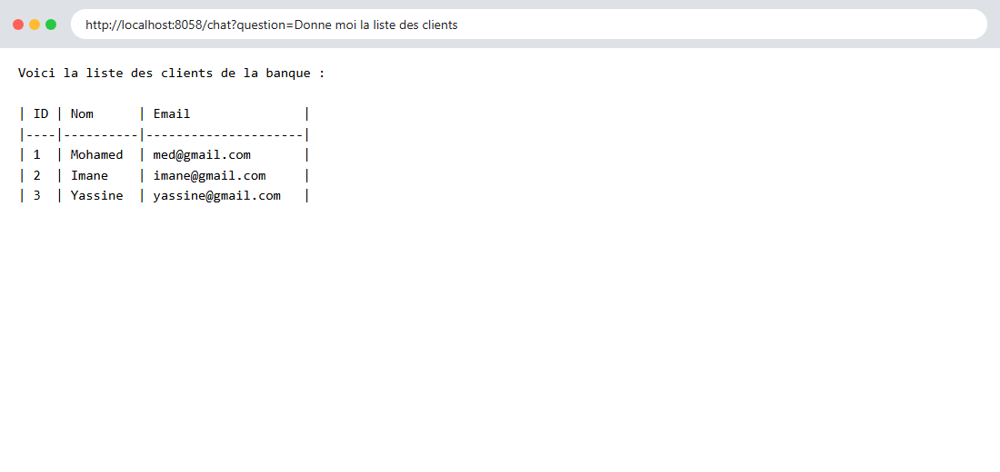

Comptes d'un client, puis une question qui fait référence à la précédente (même `chatId`) :
l'agent se souvient qu'il s'agit de Mohamed.


État du service (`/actuator/health`) :

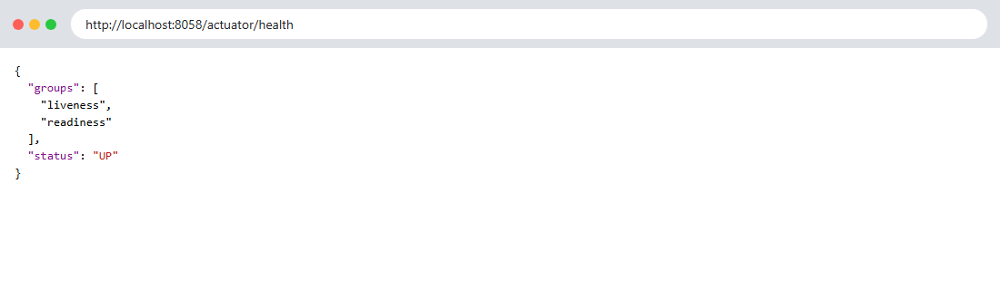

Chatbot appelé à travers la gateway :


<!-- Bot Telegram : enregistrer la capture sous captures/backend/19-telegram.png puis décommenter

-->

---

## 4. Partie Frontend

### 4.1 Choix techniques

J'ai développé l'interface avec **Angular 22** :

- **standalone components** (pas de NgModule) et **signals** pour l'état des pages ;
- **HttpClient** dans des services dédiés (`CustomerService`, `AccountService`, `ChatService`) ;
- **formulaires réactifs** avec validation (nom obligatoire, email valide, solde positif) ;
- un **interceptor HTTP** fonctionnel. L'API n'ayant pas d'authentification, il n'ajoute pas de token :
  il transforme les erreurs (gateway injoignable, service absent d'Eureka, 404, 500) en messages lisibles ;
- le rendu **markdown** des réponses du chatbot avec la librairie `marked`.

Toutes les requêtes passent par la gateway (`http://localhost:9999`) ; les URLs sont regroupées
dans `src/app/core/api.ts`.

### 4.2 Structure

```
frontend/src/app/
├── core/
│   ├── api.ts                   URLs de l'API (via la gateway)
│   ├── models.ts                Customer, BankAccount, ChatMessage
│   ├── customer.service.ts      GET/POST /customers
│   ├── account.service.ts       GET/POST /accounts
│   ├── chat.service.ts          GET /chat + historique de la conversation
│   ├── notification.service.ts  messages (toasts)
│   └── error.interceptor.ts     erreurs HTTP → message lisible
├── shared/account-type.pipe.ts  "saving-account" → "Compte épargne"
└── pages/
    ├── dashboard/               tableau de bord
    ├── customers/               liste, fiche, formulaire
    ├── accounts/                liste, fiche, formulaire
    └── chat/                    assistant IA
```

### 4.3 Pages

| Page | Route | API utilisée |
|---|---|---|
| Tableau de bord | `/` | `GET /customers`, `GET /accounts` |
| Clients (recherche) | `/customers` | `GET /customers` |
| Fiche client + ses comptes | `/customers/:id` | `GET /customers/{id}`, `GET /accounts` |
| Nouveau client | `/customers/new` | `POST /customers` |
| Comptes (filtres type / client) | `/accounts` | `GET /accounts`, `GET /customers` |
| Fiche compte + titulaire | `/accounts/:id` | `GET /accounts/{id}` |
| Ouvrir un compte | `/accounts/new` | `POST /accounts` |
| Assistant IA | `/chat` | `GET /chat?question=…&chatId=…` |

L'API ne propose pas d'endpoint « comptes d'un client » : dans la fiche client, je filtre donc la liste
complète des comptes. Dans la fiche compte, j'affiche un avertissement lorsque c'est le fallback du
circuit breaker qui a répondu.

### 4.4 Lancement

Prérequis : Node.js 20+ et le backend démarré.

```powershell
cd frontend
npm install
npm start          # http://localhost:4200
```

### 4.5 Captures d'écran

#### Tableau de bord


#### Clients

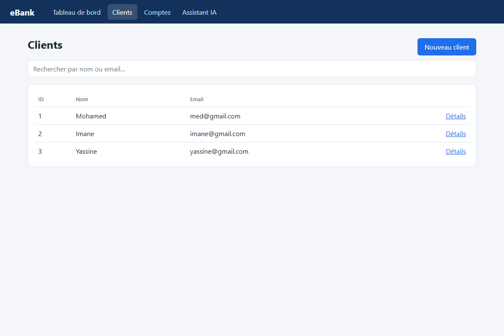

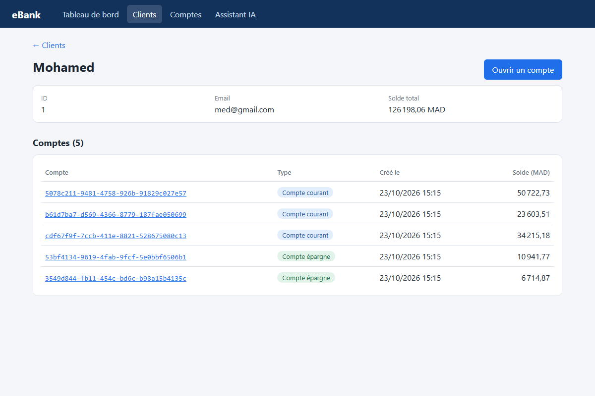


#### Comptes

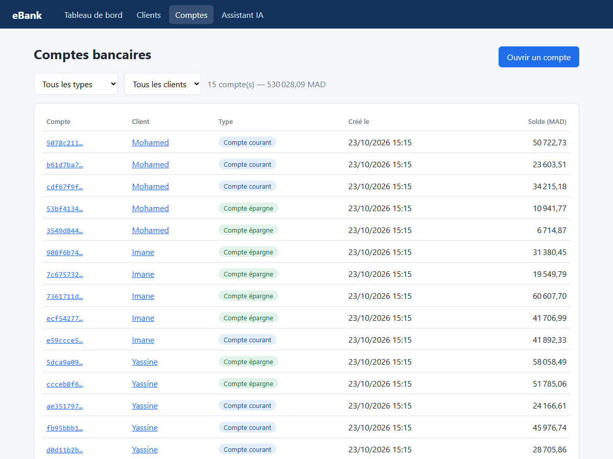


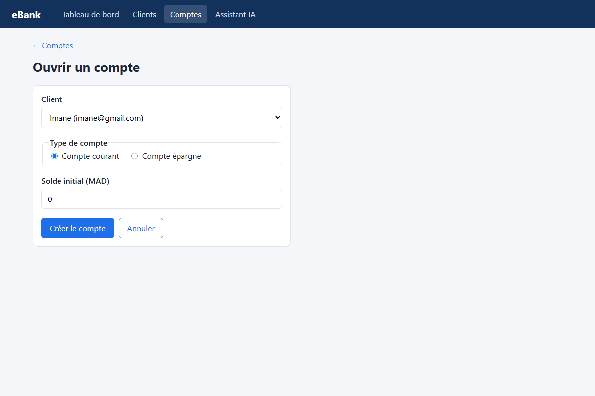

#### Assistant IA

J'ai demandé les comptes d'Imane, puis « Quel est le solde total de ses comptes ? » : l'agent
comprend que « ses » désigne Imane grâce à la mémoire de la conversation, et le total
(135 532,19 MAD) correspond bien à la somme des cinq comptes.

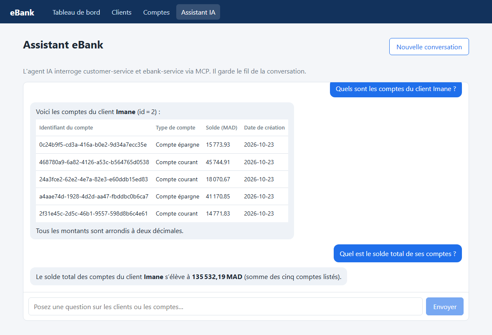

---

## 5. Sécurité

- La clé Groq est lue uniquement depuis la variable d'environnement `GROQ_API_KEY`
  (`${GROQ_API_KEY:}`), jamais écrite dans le code.
- Le token Telegram est lu uniquement depuis la variable d'environnement `TELEGRAM_BOT_TOKEN`
  et masqué dans les logs.
- Les fichiers `.env` sont ignorés par Git.
- Le CORS de la gateway n'autorise que l'origine du frontend (`http://localhost:4200`).

## 6. Difficultés rencontrées

- **Raisonnement des modèles dans les réponses** : qwen3 renvoyait son raisonnement (`<think>…</think>`)
  et gpt-oss sur Groq un champ `reasoning`. J'ai désactivé ce raisonnement dans la configuration et
  je retire ce qui reste avant de renvoyer la réponse.
- **Délai du circuit breaker** : le délai par défaut (1 s) déclenchait le fallback dès le premier appel,
  le temps que Feign s'initialise. Je l'ai porté à 5 s (`resilience4j.timelimiter`).
- **Ordre de démarrage** : le chatbot se connecte aux serveurs MCP au démarrage ; il doit donc être lancé
  après customer-service et ebank-service.
- **Bases H2 en mémoire** : elles sont recréées à chaque démarrage, donc les identifiants des comptes
  changent et les données ajoutées sont perdues au redémarrage.

## 7. Conclusion

Ce projet m'a permis de mettre en œuvre les briques principales d'une architecture microservices
(découverte de services, gateway, communication par OpenFeign, tolérance aux pannes) et d'y intégrer
un agent IA capable d'utiliser les services existants grâce au protocole MCP. Le frontend Angular
rassemble le tout dans une interface simple, et l'assistant permet d'interroger les données de la
banque en langage naturel, depuis le navigateur ou depuis Telegram.
