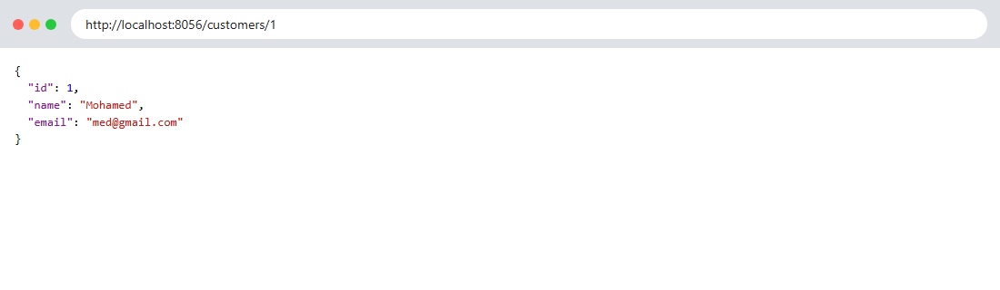
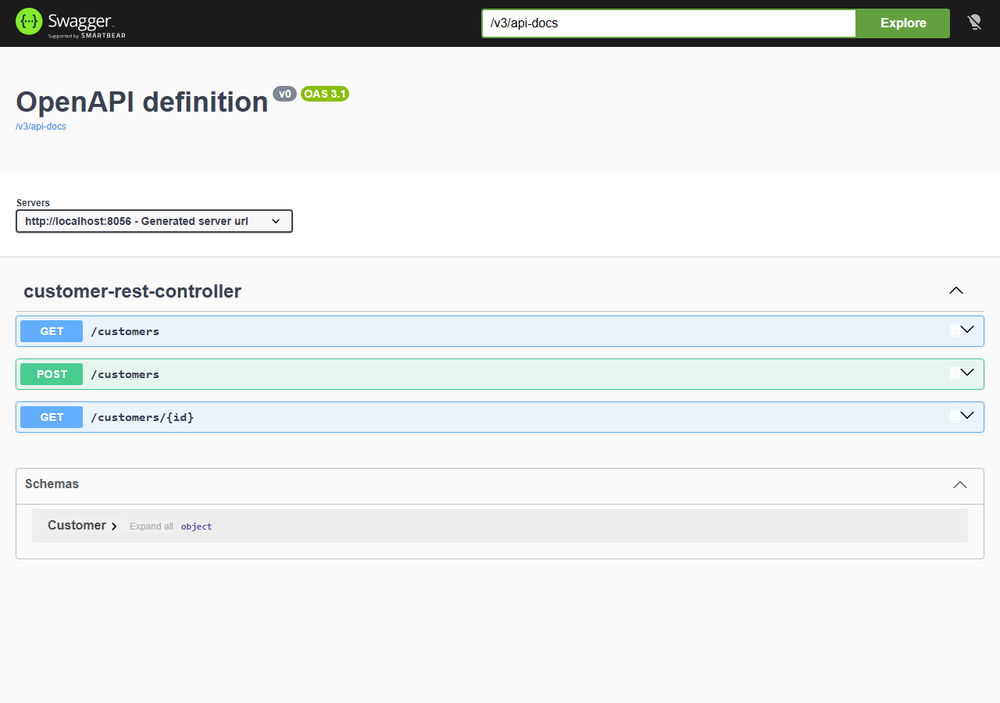
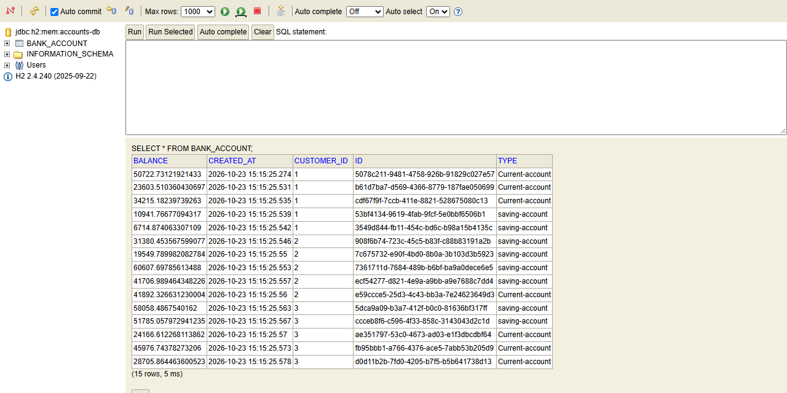
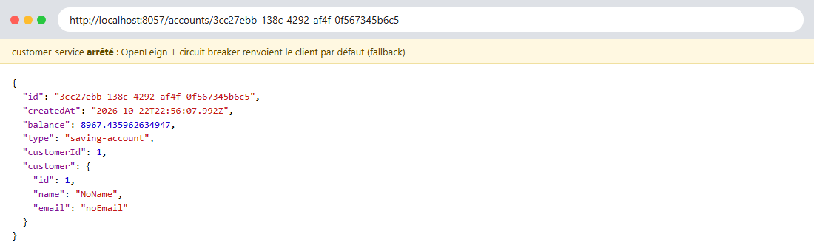
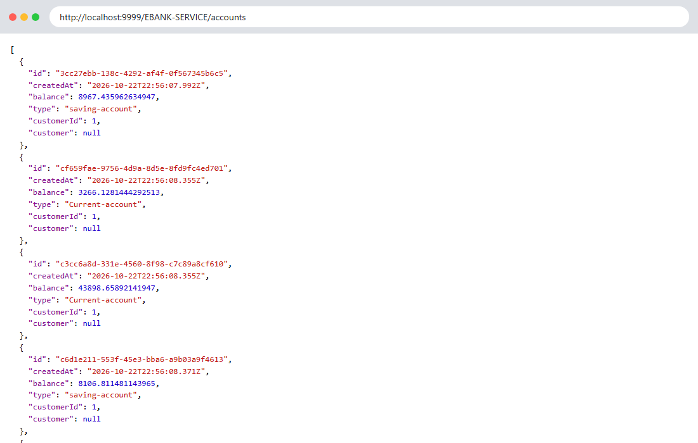
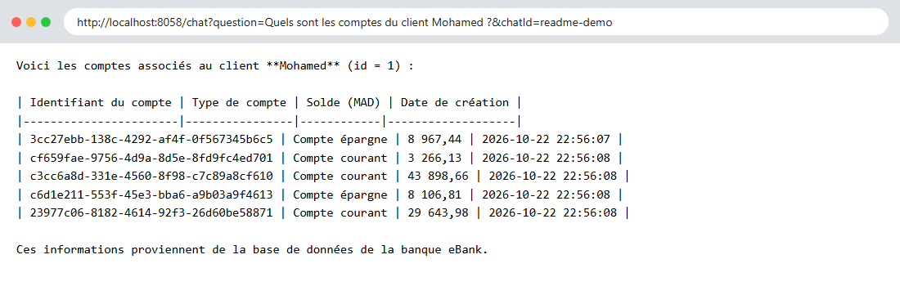
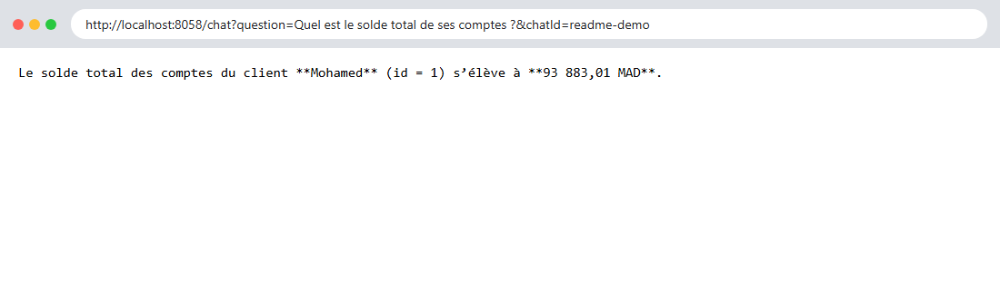
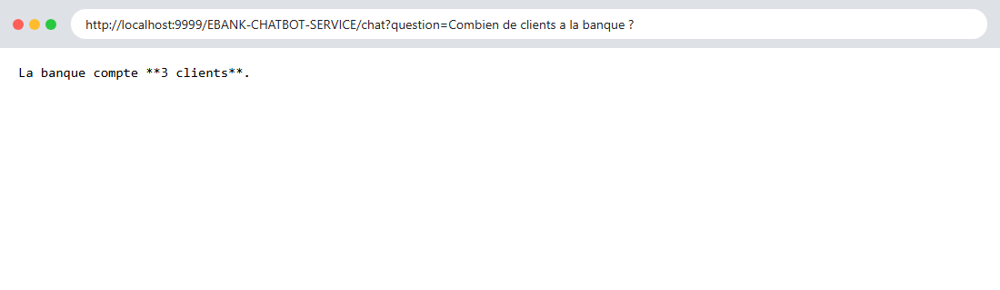

# eBank — Microservices Spring + Agent IA (MCP)

Projet microservices Spring Boot 4 / Spring Cloud 2025.1 avec un chatbot IA (Spring AI 2.0)
qui interroge les microservices via le protocole **MCP** (Model Context Protocol, Streamable HTTP)
et qui répond en REST et sur **Telegram**.

## Architecture

```
                         ┌──────────────────────┐
                         │  DISCOVERY-SERVICE   │  Eureka :8761
                         └──────────▲───────────┘
                                    │ enregistrement
   Client / Navigateur              │
          │             ┌───────────┴───────────┐
          └──────────►  │   gateway-service     │  :9999 (Spring Cloud Gateway, discovery locator)
                        └──┬─────────┬────────┬─┘
                           │         │        │
                ┌──────────▼──┐ ┌────▼──────┐ ┌▼──────────────────────┐     ┌──────────┐
                │customer-    │ │ebank-     │ │ebank-chatbot-service  │◄───►│ Telegram │
                │service :8056│ │service    │ │:8058                  │     └──────────┘
                │             │◄┤:8057      │ │ BankAgent (ChatClient)│
                │ MCP /mcp    │ │ MCP /mcp  │ │ + mémoire par chatId  │────► Ollama :11434
                └──────▲──────┘ └─────▲─────┘ └───────────┬───────────┘      (qwen3:8b)
                       │   Feign +    │                   │
                       │   CircuitBreaker                 │
                       └──────────────┴───── MCP Streamable HTTP ──┘
```

| Module | Port | Rôle |
|---|---|---|
| `DISCOVERY-SERVICE` | 8761 | Annuaire Eureka |
| `customer-service` | 8056 | Gestion des clients (JPA/H2) + serveur MCP |
| `ebank-service` | 8057 | Comptes bancaires (JPA/H2), appelle customer-service via OpenFeign + Resilience4j, serveur MCP |
| `ebank-chatbot-service` | 8058 | Agent IA (Spring AI + Ollama), client MCP, REST `/chat` et bot Telegram |
| `gateway-service` | 9999 | Point d'entrée unique, routes automatiques via Eureka |

### Outils MCP exposés

| Service | Outil | Description |
|---|---|---|
| customer-service | `getAllCustomers` | Liste de tous les clients |
| customer-service | `getCustomerById(id)` | Un client par son id |
| ebank-service | `getAllBankAccounts` | Liste de tous les comptes |
| ebank-service | `getBankAccountById(id)` | Un compte avec son client |

## Prérequis

- Java 21
- [Ollama](https://ollama.com/download) avec le modèle : `ollama pull qwen3:8b`
- (optionnel) un bot Telegram créé avec [@BotFather](https://t.me/BotFather)

## Lancement (dans cet ordre)

```powershell
# 1. Ollama doit tourner (http://localhost:11434)
ollama pull qwen3:8b

# 2. Eureka
cd DISCOVERY-SERVICE;      .\mvnw spring-boot:run
# 3. Clients
cd customer-service;       .\mvnw spring-boot:run
# 4. Comptes
cd ebank-service;          .\mvnw spring-boot:run
# 5. Chatbot (APRÈS customer-service et ebank-service : connexion MCP au démarrage)
$env:TELEGRAM_BOT_TOKEN = "<token BotFather>"   # optionnel, jamais commité
cd ebank-chatbot-service;  .\mvnw spring-boot:run
# 6. Gateway
cd gateway-service;        .\mvnw spring-boot:run
```

> Sans `TELEGRAM_BOT_TOKEN`, le bot Telegram est simplement désactivé ; `/chat` reste utilisable.

---

## Captures d'écran

Ouvrir chaque lien, faire la capture et l'enregistrer dans le dossier `captures/`
avec le nom indiqué : l'image s'affichera automatiquement ci-dessous.

### 1. Eureka — services enregistrés

🔗 http://localhost:8761

À voir : `CUSTOMER-SERVICE`, `EBANK-SERVICE`, `EBANK-CHATBOT-SERVICE`, `GATEWAY-SERVICE` à l'état UP.


### 2. customer-service

🔗 http://localhost:8056/customers


🔗 http://localhost:8056/customers/1



🔗 http://localhost:8056/swagger-ui.html



### 3. ebank-service

🔗 http://localhost:8057/accounts


🔗 http://localhost:8057/accounts/{id} — remplacer `{id}` par un id copié depuis `/accounts`

À voir : le compte avec l'objet `customer` rempli (appel Feign vers customer-service).


🔗 http://localhost:8057/swagger-ui.html


🔗 http://localhost:8057/h2-console — JDBC URL : `jdbc:h2:mem:accounts-db`, user `sa`, mot de passe vide



### 4. Circuit breaker (fallback OpenFeign)

Arrêter **customer-service**, puis rouvrir :

🔗 http://localhost:8057/accounts/{id}

À voir : `"customer": {"name": "NoName", "email": "noEmail"}` au lieu d'une erreur 500.



> Relancer customer-service ensuite (et attendre ~30 s qu'il réapparaisse dans Eureka).

### 5. Gateway

🔗 http://localhost:9999/CUSTOMER-SERVICE/customers


🔗 http://localhost:9999/EBANK-SERVICE/accounts



### 6. Serveurs MCP

Avec **MCP Inspector** (nécessite Node.js) :

```powershell
npx @modelcontextprotocol/inspector
```

Dans l'interface : *Transport Type* = `Streamable HTTP`, *URL* = `http://localhost:8056/mcp`,
cliquer **Connect** puis **List Tools** (refaire avec `http://localhost:8057/mcp`).


### 7. Chatbot — endpoint REST `/chat`

🔗 http://localhost:8058/chat?question=Donne moi la liste des clients


🔗 http://localhost:8058/chat?question=Quels sont les comptes du client Mohamed ?&chatId=demo



Mémoire de conversation (même `chatId`, la question fait référence à la précédente) :

🔗 http://localhost:8058/chat?question=Quel est le solde total de ses comptes ?&chatId=demo



🔗 http://localhost:8058/actuator/health


### 8. Chatbot via la gateway

🔗 http://localhost:9999/EBANK-CHATBOT-SERVICE/chat?question=Combien de clients a la banque ?



### 9. Bot Telegram

Lancer le chatbot avec la variable `TELEGRAM_BOT_TOKEN`, ouvrir le bot dans Telegram
(lien `https://t.me/<nom_du_bot>` donné par BotFather), envoyer `/start` puis une question,
par exemple *« Liste les comptes du client 2 »*.


---

## Sécurité

- Le token Telegram est lu uniquement depuis la variable d'environnement `TELEGRAM_BOT_TOKEN`
  (`application.yml` : `${TELEGRAM_BOT_TOKEN:}`) et masqué dans les logs.
- `.env` est ignoré par Git.
