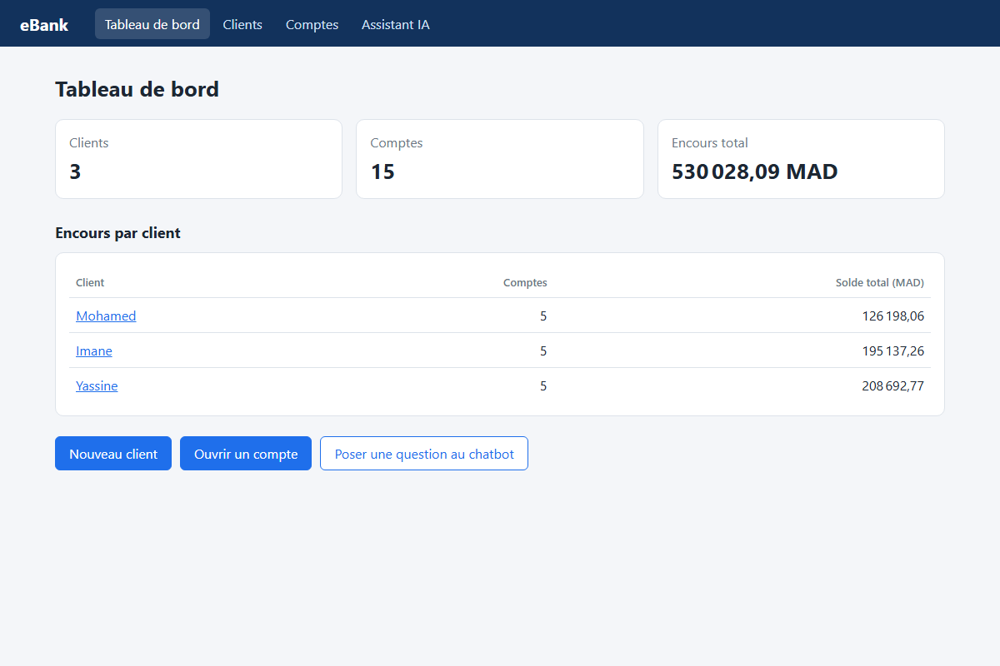
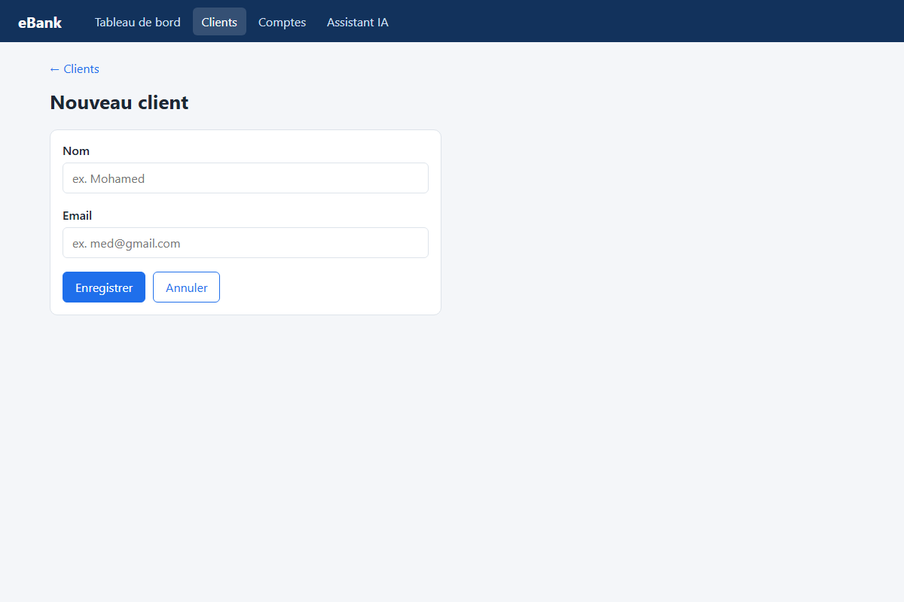
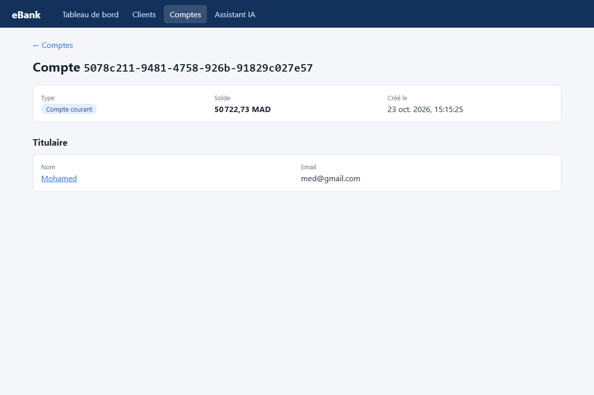
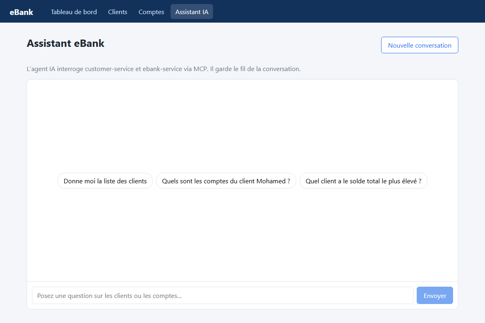

# eBank — Frontend Angular

Interface web du projet eBank : gestion des clients, des comptes bancaires et accès à l'assistant IA.
Le backend (microservices Spring, gateway, chatbot MCP) est décrit dans le [README principal](../README.md).

- Angular 22 : standalone components, signals, nouveau control flow (`@if`, `@for`)
- `HttpClient` + interceptor fonctionnel de gestion des erreurs
- Formulaires réactifs avec validation
- Rendu markdown des réponses du chatbot (`marked`)

## Architecture

```
Navigateur :4200 ──► gateway-service :9999 ──► /CUSTOMER-SERVICE/customers
   (Angular)          (CORS autorisé            /EBANK-SERVICE/accounts
                       pour :4200)              /EBANK-CHATBOT-SERVICE/chat
```

Toutes les requêtes passent par la gateway : les URLs sont définies dans `src/app/core/api.ts`.
Le CORS est configuré une seule fois, côté gateway
(`gateway-service/src/main/resources/application.properties`, origine `http://localhost:4200`).

```
src/app/
├── core/
│   ├── api.ts                   URLs de l'API (via la gateway)
│   ├── models.ts                Customer, BankAccount, ChatMessage
│   ├── customer.service.ts      GET/POST /customers
│   ├── account.service.ts       GET/POST /accounts
│   ├── chat.service.ts          GET /chat + historique de conversation
│   ├── notification.service.ts  messages (toasts)
│   └── error.interceptor.ts     erreurs HTTP → message lisible
├── shared/account-type.pipe.ts  "saving-account" → "Compte épargne"
└── pages/
    ├── dashboard/               tableau de bord
    ├── customers/               liste, fiche, formulaire
    ├── accounts/                liste, fiche, formulaire
    └── chat/                    assistant IA
```

L'API n'a pas d'authentification : l'interceptor n'ajoute donc pas de token, il transforme
les erreurs HTTP (gateway injoignable, service absent d'Eureka, 404, 500) en messages lisibles.

## Pages

| Page | Route | API utilisée |
|---|---|---|
| Tableau de bord | `/` | `GET /customers`, `GET /accounts` |
| Clients (recherche) | `/customers` | `GET /customers` |
| Fiche client + ses comptes | `/customers/:id` | `GET /customers/{id}`, `GET /accounts` |
| Nouveau client | `/customers/new` | `POST /customers` |
| Comptes (filtres type / client) | `/accounts` | `GET /accounts`, `GET /customers` |
| Fiche compte + titulaire | `/accounts/:id` | `GET /accounts/{id}` |
| Ouvrir un compte | `/accounts/new` | `POST /accounts` |
| Assistant IA | `/chat` | `GET /chat?question=…&chatId=…` |

- L'API n'a pas d'endpoint « comptes d'un client » : la fiche client filtre la liste complète des comptes.
- Si customer-service est arrêté, la fiche compte affiche un avertissement (réponse du fallback du circuit breaker).
- L'assistant garde la mémoire de la conversation grâce à un `chatId` propre à l'onglet.

## Lancement

Prérequis : Node.js 20+ et le backend lancé (au minimum Eureka, customer-service, ebank-service et la gateway ;
le chatbot pour la page Assistant IA).

```powershell
cd frontend
npm install
npm start          # http://localhost:4200
```

Build de production : `npm run build` (sortie dans `dist/frontend`).

## Captures d'écran

### Tableau de bord



### Clients




### Comptes





### Assistant IA


